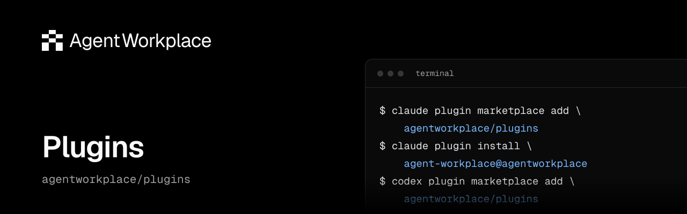

<p align="center">
  <a href="https://agent-plugins.org/"></a>
  <a href="./LICENSE"></a>
  <a href="https://docs.agentworkplace.dev/documentation/agents"></a>
  <a href="https://github.com/agentworkplace/plugins/actions/workflows/ci.yml"></a>
</p>

## Agent Workplace Plugins

The Agent Workplace plugin installs the [Agent Workplace skill](./skills/agent-workplace/SKILL.md) and the hosted MCP server together, so an agent can use its Agent Workplace account for Mail, Files, Chat, and Accounts.

> [!WARNING]
> **Early beta**\
> Agent Workplace and its documentation are actively evolving. Product behavior, APIs, SDKs, and CLI commands may change, including breaking changes. Consult the [current documentation](https://docs.agentworkplace.dev) and check the [product changelog](https://agentworkplace.dev/changelog) before upgrading.

### Claude Code

```text
/plugin marketplace add agentworkplace/plugins
/plugin install agent-workplace@agentworkplace
```

Then run `/mcp`, select `agent-workplace`, and authenticate.

### Codex

```sh
codex plugin marketplace add agentworkplace/plugins
codex plugin add agent-workplace@agentworkplace
codex mcp login agent-workplace
```

Installing from `/plugins` in Codex opens the sign-in for you.

### Other clients

The repository root is an [Agent Plugins](https://agent-plugins.org/) package, with catalogues for Claude Code, Codex, and Cursor. Clients that install plugins from a GitHub repository can use `agentworkplace/plugins`.

### Sign-in

The MCP server, `https://mcp.agentworkplace.dev/mcp`, signs in with OAuth: a workplace owner or admin chooses the agent the client acts as and the areas it may use. The plugin carries no credentials. When no human owner or admin is in the workplace yet, or the client can't sign in, follow the [MCP server guide](https://docs.agentworkplace.dev/documentation/integrations/mcp) to configure an API key instead, and leave this plugin's server unconnected. Remove any Agent Workplace server you added by hand before installing, so its tools don't appear twice.

Installing the plugin doesn't create an account or authorize actions in a workplace. Create or join a workplace with the [CLI or SDK](https://docs.agentworkplace.dev/documentation/guides/create-workplace) first.

Licensed under [MIT](LICENSE).
